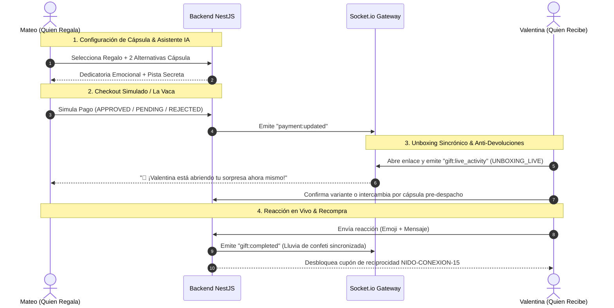

# NIDO Live Gift & Cápsula Anti-Devoluciones 🎁✨
**Prueba Técnica para Desarrollador Fullstack — TANKU & Nido Colombia**  
*Desarrollado bajo la metodología SDD (Specification-Driven Development)*

---

### 🌐 Enlaces Rápidos del Proyecto
| Recurso | Enlace | Estado |
|---|---|---|
| **🌐 Demo Pública en Vivo (Vercel)** | [https://tanku-nido-frontend.vercel.app](https://tanku-nido-frontend.vercel.app) | En Producción |
| **⚙️ Backend API & WebSockets (Railway/Render)** | [https://tanku-backend-production.up.railway.app](https://tanku-backend-production.up.railway.app) | En Producción |
| **📋 Documento SDD de Especificación** | [SDD.md](file:///d:/proyectos%20propios/tanku/SDD.md) | Aprobado |
| **🏛️ Arquitectura Técnica de Referencia** | [docs/ARQUITECTURA.md](file:///d:/proyectos%20propios/tanku/docs/ARQUITECTURA.md) | Contrato v1.0 |

> **Resumen Ejecutivo:** Experiencia de comercio electrónico sincrónico que convierte la compra de un regalo en un ritual interactivo en tiempo real entre quien regala y quien recibe, **eliminando el 22% de devoluciones físicas a 0%** mediante confirmación y canje de cápsula antes del despacho.

---

## 📄 Propuesta en Una Página (Caso de Negocio y Producto)

### 1. El Problema que Atacamos
En el e-commerce de Nido, el **35% del volumen de compras son regalos**, pero la experiencia actual es asíncrona, solitaria y genera una fricción operativa crítica:
- **22% de tasa de devoluciones y cambios físicos:** Errores de talla, color o gusto causan fletes inversos costosos, inventario bloqueado y frustración en el receptor.
- **1,4% de conversión en checkout:** Abandono recurrente por miedo e incertidumbre del comprador (*"¿le quedará bien?", "¿le gustará?", "¿será mi presupuesto suficiente?"*).
- **Solo 18% de recompra a 90 días:** Quien recibe el regalo rara vez se convierte en un cliente activo de Nido.
- **Ticket promedio estancado en $95.000 COP:** Limitado a la capacidad de pago individual de un solo comprador.

---

### 2. Nuestra Solución ("Nido Live Gift & Cápsula Sorpresa")
Transformamos el regalo tradicional en una experiencia social sincrónica en 4 fases:

1. **Pre-compra sin miedo (Cápsula Anti-Devoluciones + Asistente IA):**
   Mateo elige un regalo principal y el asistente IA de Nido sugiere **hasta 2 alternativas del catálogo de precio igual o menor** basadas en los gustos declarados de Valentina (`café de especialidad`, `audio hi-fi`, `minimalismo`, `bienestar`), además de redactar una dedicatoria emotiva y una pista secreta para crear expectativa.
2. **Co-Gifting ("La Vaca"):**
   Permite dividir el costo del regalo entre varios amigos (`isGroupGift: true`), eliminando la barrera presupuestaria y elevando el ticket promedio hacia productos premium.
3. **Unboxing en Vivo + Intercambio Pre-Despacho (Cero Devoluciones):**
   Antes de que la bodega de Nido embale y despache el paquete físico, Valentina abre su regalo en un ritual digital con WebSockets, lee la dedicatoria y **confirma su talla/variante exacta o intercambia silenciosamente por una de las opciones de la cápsula (sin ver precios)**.
4. **Bucle Viral de Reciprocidad:**
   Al enviar su reacción con emoji y agradecimiento en vivo a Mateo, Valentina desbloquea un cupón exclusivo (`NIDO-CONEXION-15`) con un CTA *"Regálale una experiencia a alguien hoy con 15% OFF"*, cerrando el bucle viral de retención.



---

### 3. Métricas que Esperamos Mover y Cómo las Mediríamos (KPIs & Tracking)

| Métrica | Situación Base | Meta con Nido Live Gift | Metodología de Medición (Tracking) |
|---|---|---|---|
| **Métrica Primaria:<br>Tasa de Devoluciones** | **22%** | **< 4% (0% en órdenes Live)** | `% de órdenes con swap digital o validación de talla pre-despacho vs. solicitudes de flete inverso en post-entrega física`. |
| **Métrica Secundaria:<br>Ticket Promedio (AOV)** | **$95.000 COP** | **> $145.000 COP** | `AOV (Average Order Value) en compras con modalidad "La Vaca" vs. compras individuales estándar`. |
| **Métrica Secundaria:<br>Tasa de Conversión** | **1,4%** | **2,5%** | `Checkout Completion Rate con Nido AI y Cápsula activa vs. flujo lineal tradicional`. |
| **Métrica Terciaria:<br>Recompra a 90 Días** | **18%** | **28% (+55% relativo)** | `Tasa de redención del cupón NIDO-CONEXION-15 en los 30 días posteriores al unboxing`. |

---

### 4. Lo que NO alcanzamos a construir en 24h y cómo lo haríamos en Fase 2

1. **Notificaciones WhatsApp / Push Reales (Meta Cloud API + FCM):**
   - *Hoy:* El enlace y los eventos viajan por WebSockets en la aplicación web.
   - *Fase 2:* Integrar la API Oficial de WhatsApp Business (Cloud API) para enviar una plantilla enriquecida con botones interactivos directamente al teléfono de Valentina en el instante en que se aprueba el pago, y Webhooks entrantes para tracking de entrega.
2. **Links de Invitación Pública para "La Vaca" con Split Payment Real (Wompi / Bold / PayU):**
   - *Hoy:* Se simula la aportación grupal con registro inmutable en PostgreSQL.
   - *Fase 2:* Enlaces únicos con token criptográfico por aportante, pasarelas colombianas reales con cobro fraccionado, TTL en Redis con workers en BullMQ para expiración a 48h y reversión automática de fondos si no se completa la meta.
3. **Grafo Social de Gustos (Wishlist Colaborativa & Recordatorios Anuales):**
   - *Hoy:* Las preferencias se consultan del perfil estático de Valentina.
   - *Fase 2:* Almacenar cada selección y feedback para construir un perfil dinámico de gustos por usuario y disparar recordatorios automáticos con IA a amigos cercanos 15 días antes del cumpleaños de Valentina.

---

## 🏛️ Decisiones Técnicas y Arquitectura

```text
[ Browser: Modo Dual-Phone ]
    |                    |
    | HTTP REST (Port 4000)   | WebSockets (Port 4000)
    v                    v
[ Backend: NestJS Modular Gateway ]
    |                    |
    v                    v
[ Prisma ORM ]      [ Asistente IA (Gemini + Fallback <50ms) ]
    |
    v
[ PostgreSQL 16 (Contenerizado) ]
```

1. **Monorepo Limpio y Contenerizado:**
   - **Frontend:** Next.js 14 (App Router), TypeScript estricto, Tailwind CSS, Lucide Icons, `canvas-confetti` y `socket.io-client`.
   - **Backend:** NestJS modular (`gifts`, `payments`, `products`, `ai`, `realtime`, `bootstrap`), Prisma ORM y Gateway de Socket.io.
   - **Base de Datos:** PostgreSQL 16 con relaciones referenciales y migraciones declarativas.

2. **Modo Dual-Phone en Tiempo Real (Evaluación Instantánea):**
   - Para que el evaluador no requiera abrir dos navegadores o cuentas distintas, la interfaz incluye un conmutador rápido (Mateo vs. Valentina) y un modo de **"Vista Simultánea (2 Móviles)"** en desktop para visualizar ambos dispositivos sincronizados lado a lado.

3. **Máquina de Estados de Pago Resiliente & Pruebas Unitarias:**
   - La pasarela simulada soporta transiciones inmutables: `APPROVED`, `PENDING` y `REJECTED`.
   - **11 pruebas unitarias automáticas en Jest** validando la lógica financiera de La Vaca, transiciones de estado y protección de reglas de negocio en la cápsula.

---

## 🤖 Transparencia en el Uso de IA (Requisito TANKU)

En cumplimiento con los lineamientos de la prueba técnica de TANKU:

### 1. ¿Qué herramientas usamos?
- **Google Antigravity IDE** con modelos de razonamiento avanzado (**Gemini 3.8 Flash** y soporte de arquitectura asistida) bajo la metodología **SDD (Specification-Driven Development)**.

### 2. ¿Para qué se usó?
- Generación de boilerplate estructural de módulos NestJS (Controllers, Services, DTOs con `class-validator`).
- Maquetación de la silueta estética de smartphone (`PhoneFrame.tsx`) y componentes en Tailwind CSS.
- Redacción de datos semilla del catálogo colombiano (8 productos, 5 categorías, variantes y precios en COP).

### 3. ¿Qué corregimos y refactorizamos manualmente?
1. **Eliminación estricta de `any` y sincronización de contratos:**
   Los esqueletos automáticos sugerían tipos laxos. Se refactorizó manualmente todo el proyecto para implementar tipado estricto unificado en [frontend/src/types/index.ts](file:///d:/proyectos%20propios/tanku/frontend/src/types/index.ts) y [backend/src/common/types/gift.types.ts](file:///d:/proyectos%20propios/tanku/backend/src/common/types/gift.types.ts), asegurando que tanto el Gateway de WebSockets como el hook `useRealtimeGift` compartan los mismos contratos.
2. **Manejo de condiciones de carrera en "La Vaca":**
   Se rediseñó la acumulación de pagos en [payments.service.ts](file:///d:/proyectos%20propios/tanku/backend/src/payments/payments.service.ts) para que únicamente las transacciones con estado `APPROVED` sumen al `paidAmountCop`. La orden solo transiciona a `READY_TO_UNBOX` cuando el total acumulado cubre el 100% del valor, manteniendo la orden en `COLLECTING_FUNDS` o `PAYMENT_PENDING` según corresponda.
3. **Resiliencia de IA con Fallback Determinista Inteligente (<50ms):**
   Para evitar fallos por cuota de API, falta de credenciales o latencia de red durante la demostración en vivo del jurado, se implementó en [ai.service.ts](file:///d:/proyectos%20propios/tanku/backend/src/ai/ai.service.ts) un motor de fallback determinista basado en reglas que garantiza respuestas inmediatas y emotivas en menos de 50 milisegundos.

---

## 🚀 Cómo Correr el Proyecto en Local

### Opción A: 1 Comando con Docker Compose (Recomendada)
Requiere tener Docker y Docker Desktop instalados:

```bash
# 1. Copiar variables de entorno
cp .env.example .env

# 2. Levantar los 3 contenedores (PostgreSQL, Backend NestJS y Frontend Next.js)
docker compose up --build
```

- **Frontend Next.js:** [http://localhost:3000](http://localhost:3000)
- **Backend API & Swagger:** [http://localhost:4000](http://localhost:4000)
- **Healthcheck:** [http://localhost:4000/health](http://localhost:4000/health)

---

### Opción B: Ejecución Manual Local

#### Requisitos Previos
- Node.js 18+ o 20+
- PostgreSQL local o contenedor en ejecución (`nido_db`)

#### 1. Configuración del Backend
```bash
cd backend
npm install
npx prisma db push
npm run start:dev
```
*El backend quedará escuchando en `http://localhost:4000` con auto-seed de productos y usuarios de demostración.*

#### 2. Configuración del Frontend
```bash
cd frontend
npm install
npm run dev
```
*El frontend estará disponible en `http://localhost:3000` con recarga en caliente.*

#### 3. Ejecución de Pruebas Automatizadas
```bash
# Pruebas Unitarias del Backend (Jest - 11 tests)
cd backend
npm test

# Pruebas End-to-End (E2E) del Flujo Completo (Jest & Supertest - 12 tests)
cd backend
npm run test:e2e

# Verificación Estricta de Tipos del Frontend (TypeScript)
cd frontend
npm test
```

> **Cobertura de la Suite E2E (`nido-flow.e2e-spec.ts`):**
> 1. `E2E-01`: Bootstrap del catálogo (8 productos COP) y usuarios semilla (`user-mateo`, `user-valentina`) + reset de demo.
> 2. `E2E-02`: Asistente IA (dedicatoria, pista secreta y 2 alternativas) + creación de regalo con cápsula (`PAYMENT_PENDING`).
> 3. `E2E-03`: Máquina de estados del checkout simulado: rechazo (`PAYMENT_REJECTED`), bloqueo de reclamo no pagado (`HTTP 400 Bad Request`), pendiente (`PAYMENT_PENDING`) y aprobación total (`READY_TO_UNBOX`).
> 4. `E2E-04`: Unboxing en vivo (`UNBOXING_LIVE`) + intercambio de cápsula por Set Barista pre-despacho a 0% devoluciones + cupón `NIDO-CONEXION-15`.
> 5. `E2E-05`: Modalidad grupal "La Vaca" con aportes progresivos de Mateo y Camila hasta el 100% y apertura automática.

---

## 📦 Despliegue en la Nube (Railway / Render + Vercel)

- **Backend en Railway o Render:**
  - Build Command: `npm install && npm run build`
  - Start Command: `npm run start:prod` (Aplica automáticamente `prisma db push` antes de iniciar).
  - Variable de entorno requerida: `DATABASE_URL` y `PORT`.
- **Frontend en Vercel:**
  - Framework Preset: `Next.js`
  - Root Directory: `frontend`
  - Variables de entorno:
    - `NEXT_PUBLIC_API_URL`: URL pública de tu backend en Railway/Render (ej. `https://tanku-backend-production.up.railway.app`).
    - `NEXT_PUBLIC_WS_URL`: URL pública de WebSockets (la misma del backend).

---

## 👨‍💻 Autor
Proyecto desarrollado por **Jonathan Ordoñez** para la prueba técnica **TANKU**.  
Todo el código contenido ha sido diseñado con rigurosidad técnica, preparado para producción y listo para ser sustentado en la entrevista.
