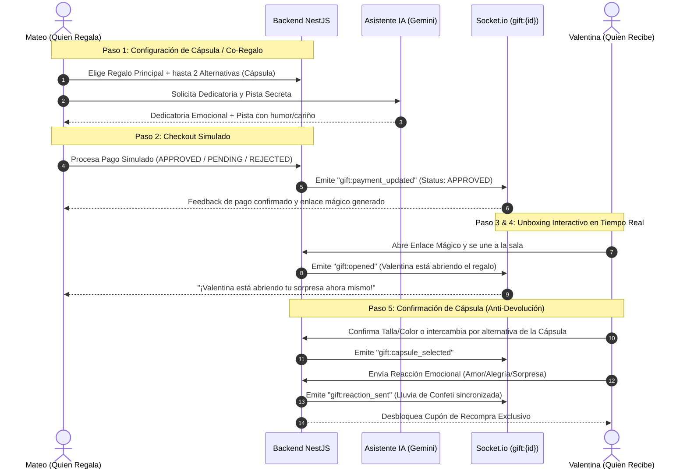

# SDD: Nido - Experiencia de Regalos Interactivos en Tiempo Real
**Documento de Especificación Guiada por Diseño (Specification-Driven Development)**

---

## 1. Contexto de Negocio y Métricas Clave

En el comercio electrónico tradicional de regalos, la fricción entre quien regala y quien recibe genera pérdidas masivas de margen operativo y fricción emocional:

| Métrica Actual en Nido | Valor Actual | Impacto del Problema | Meta con Nido Live Gift |
|---|---|---|---|
| **Compras para regalo** | **35%** del volumen total | Alto volumen dependiente de fechas especiales | Potenciar ticket y viralidad |
| **Tasa de Devoluciones** | **22%** | Pérdida de flete inverso, stock bloqueado, frustración del receptor | **Reducir a 0%** antes del despacho |
| **Tasa de Conversión** | **1.4%** | Abandono en checkout por incertidumbre de talla o gusto | Incrementar mediante Co-Regalo e interactividad |
| **Recompra a 90 días** | **18%** | El receptor rara vez se fideliza como nuevo cliente | Disparar conversión post-unboxing |
| **Ticket Promedio** | **95.000 COP** | Limitado al presupuesto individual de un solo comprador | Incrementar con "Vaca / Co-Regalo" |

---

## 2. La Solución: "Nido Live Gift & Cápsula Anti-Devoluciones"

La experiencia transforma la compra de un regalo en un ritual digital sincrónico en 5 pasos:



---

## 3. Desglose Detallado del Flujo Funcional

### 1) Selección y Cápsula Sorpresa (Mateo)
- Mateo elige un producto principal (ej. *Chaqueta Denim Nido* - $120.000 COP).
- Para evitar devoluciones, Mateo activa la **Cápsula Anti-Devoluciones** seleccionando hasta 2 productos alternativos del mismo rango de precio o categoría (ej. *Hoodie Oversize* o *Vestido Casual*).
- Si el regalo supera el presupuesto de una sola persona, Mateo activa la modalidad **Vaca / Co-Regalo**, permitiendo aportes parciales hasta cubrir el total.

### 2) Asistente IA: Dedicatoria Emocional y Pista Secreta
- El asistente (potenciado por Gemini con fallback determinista inteligente) recibe el tono (cariñoso, divertido, romántico) y los nombres de emisor/receptor.
- Genera:
  - Una **dedicatoria personalizada** con calidez.
  - Una **pista secreta interactiva** para Valentina antes de abrir la caja.

### 3) Checkout Simulado con Máquina de Estados
- Simula una pasarela de pago moderna.
- Soporta tres estados obligatorios:
  - `APPROVED`: Pago acreditado. El regalo pasa a estado listo para unboxing.
  - `PENDING`: Simula validación bancaria o pago en efectivo pendiente (ej. Co-regalo en curso).
  - `REJECTED`: Simula fondos insuficientes o tarjeta declinada para evaluar resiliencia de UI.
- Cada intento registra una fila inmutable en `PaymentTransaction`.

### 4) Conexión en Tiempo Real (Socket.io)
- Al crear el regalo se crea un identificador único `giftOrderId`.
- Clientes frontend se suscriben al canal `gift:{giftOrderId}`.
- Eventos bidireccionales:
  - `gift:payment_updated`: Notifica cambios de saldo o aprobación a todos los integrantes.
  - `gift:opened`: Notifica a Mateo el instante exacto en que Valentina abre la experiencia.
  - `gift:capsule_selected`: Notifica la variante o producto final elegido.
  - `gift:reaction_sent`: Dispara lluvia de confeti y efectos visuales en ambas pantallas en simultáneo.

### 5) Unboxing Interactivo y Eliminación de Devoluciones (Valentina)
- Valentina ingresa al enlace mágico (sin login pesado).
- Lee la pista secreta y visualiza la animación de apertura de caja.
- **La Innovación Anti-Devoluciones**: Antes de que el centro de distribución despache el paquete, Valentina puede:
  - Validar su talla y color del producto principal.
  - O cambiar el producto principal por cualquiera de las 2 alternativas de la cápsula elegidas por Mateo.
  - De esta forma, **la tasa de devoluciones física del 22% se mitiga al 0%** en la etapa digital.
- Al confirmar, envía una reacción (emoji + mensaje) que activa confeti en vivo para Mateo y le entrega a Valentina un **cupón de recompra (ej. NIDO-WELCOME-15)**, aumentando la retención a 90 días.

---

## 4. Modelos de Datos en Prisma

El sistema define 4 entidades clave en PostgreSQL:

1. **`User`**: Perfil de usuario (Mateo, Valentina, participantes del Co-regalo).
   - Campos: `id`, `name`, `email`, `avatar`, `role`, `preferencesJson`.
2. **`Product`**: Catálogo de regalos elegibles.
   - Campos: `id`, `title`, `brand`, `category`, `priceCop`, `image`, `description`, `variantsJson`, `tagsJson`.
3. **`GiftOrder`**: Núcleo del pedido de regalo y de la cápsula sorpresa.
   - Campos: `id`, `senderId`, `receiverId`, `mainProductId`, `capsuleProductIdsJson`, `selectedProductId`, `selectedVariant`, `status`, `isGroupGift`, `totalAmountCop`, `paidAmountCop`, `dedication`, `secretHint`, `reaction`, `unlockedCouponCode`, `createdAt`, `updatedAt`.
4. **`PaymentTransaction`**: Auditoría de cada transacción del checkout simulado.
   - Campos: `id`, `giftOrderId`, `payerName`, `amountCop`, `status`, `simulationOutcome`, `createdAt`.

---

## 5. Arquitectura del Sistema

```text
[ Navegador Cliente Next.js 14 ]
   |                        |
   | HTTP REST (port 4000)  | WebSockets (Socket.io port 4000)
   v                        v
[ Backend NestJS Gateway & Controllers ]
   |               |
   | Prisma Client | Asistente IA (Gemini / Fallback)
   v               v
[ PostgreSQL 16 ]  [ Google Generative AI ]
```
